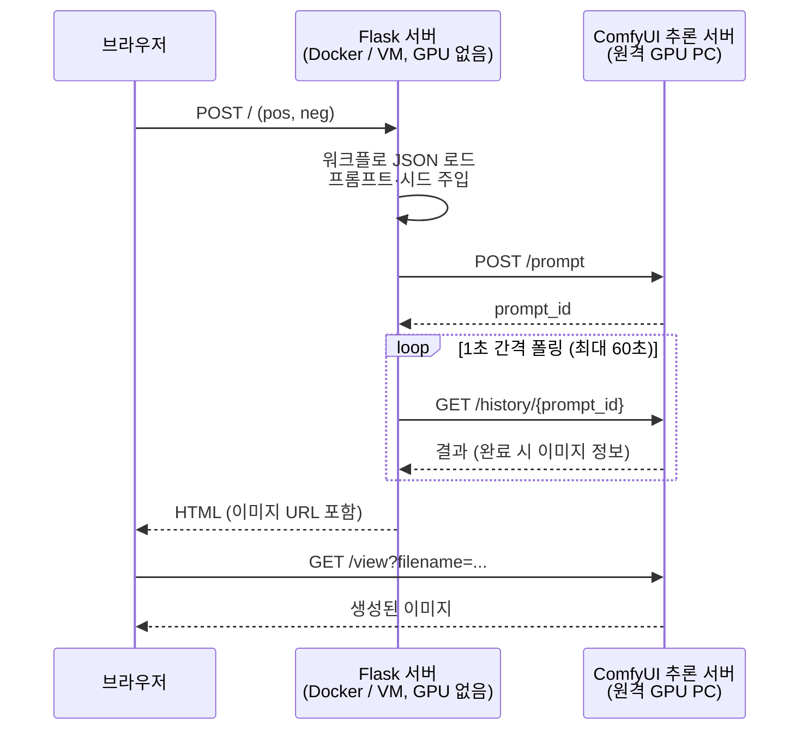

# ComfyUI Studio: 텍스트로 이미지를 만드는 웹 앱

> 프롬프트를 입력하면 **원격 GPU PC의 ComfyUI API**로 이미지 생성 워크플로(Flux.2 Klein / SDXL Turbo)를 실행하고, 생성된 이미지를 웹에서 바로 보여주는 Flask 애플리케이션입니다.

<!-- 스크린샷: docs/images/screenshot.png 파일을 추가하면 아래에 표시됩니다 -->


<br>

## 프로젝트 개요

| 항목 | 내용 |
| --- | --- |
| 목적 | ComfyUI의 노드 기반 워크플로를 **누구나 쓸 수 있는 웹 UI**로 감싸기 |
| 기능 | Positive/Negative 프롬프트 입력 → 이미지 생성 → 결과 표시 |
| 모델 | **Flux.2 Klein 4B** (1024×1024, 20스텝, 현재 기본) / SDXL Turbo (512×512, 1스텝) |
| 구성 | 웹 앱(VM, GPU 없음)과 추론 서버(원격 GPU PC의 ComfyUI)를 분리 |
| 배포 | Docker 개발 환경 → 학교 VMware 서버(Linux)에 배포 |

ComfyUI는 강력하지만 노드 그래프 화면이 복잡해서 처음 쓰는 사람이 다루기 어렵습니다.
이 프로젝트는 ComfyUI에서 만든 워크플로를 **API 형식 JSON**으로 저장해 두고, 웹에서는 프롬프트만 입력하면 되도록 만들었습니다.
워크플로 JSON만 바꾸면 다른 모델로 교체할 수 있어서, SDXL Turbo로 시작해 **다른 PC의 ComfyUI 서버에서 받은 Flux.2 워크플로**로 확장했습니다.

<br>

## 주요 기능

- **텍스트 → 이미지 생성**: Positive / Negative 프롬프트로 이미지 생성
- **원격 추론 서버 연동**: 같은 네트워크의 다른 GPU PC에서 돌아가는 ComfyUI로 생성 요청
- **워크플로 교체**: ComfyUI에서 내보낸 API 형식 JSON(`flux2.json`, `test.json`)으로 모델 전환
- **매번 다른 결과**: 요청마다 시드를 랜덤으로 바꿔 같은 프롬프트로도 새로운 이미지 생성
- **생성 상태 표시**: 생성 중에는 버튼 비활성화, 스피너, 결과 영역 애니메이션
- **다크 UI**: 다크 베이스에 네온 그린 포인트, 모바일 반응형 레이아웃
- **환경 변수 설정**: ComfyUI 주소를 코드 수정 없이 환경 변수로 변경
- **Docker 지원**: `docker compose up` 한 줄로 실행 환경 구성

<br>

## 아키텍처



| 구성 요소 | 역할 |
| --- | --- |
| **Flask** (`app2.py`) | 워크플로에 프롬프트를 주입하고 ComfyUI에 제출, 완료될 때까지 폴링 |
| **ComfyUI** | 실제 이미지 생성 (원격 PC의 GPU) |
| **워크플로** (`static/flux2.json`, `static/test.json`) | ComfyUI에서 설계한 노드 그래프 (API 형식) |
| **템플릿** (`templates/image.html`) | 입력 폼과 결과 화면 |

<br>

## 기술 스택

| 분류 | 사용 기술 |
| --- | --- |
| Backend | Python 3.12, Flask, requests |
| AI / 이미지 생성 | ComfyUI, Flux.2 Klein 4B, Stable Diffusion XL Turbo |
| Frontend | HTML, CSS, Vanilla JS (Jinja2 템플릿, 외부 라이브러리 없음) |
| Infra | Docker, Docker Compose, VMware (Linux VM), SSH / scp |

**테스트 환경**: ComfyUI 0.45.0 · PyTorch 2.15.0 (CUDA 13.2) · NVIDIA RTX 3080 10GB · Flask 3.1.3 · Python 3.12 ([상세](docs/README.md#테스트한-환경))

<br>

## 핵심 구현

### 1. 워크플로 재사용과 프롬프트 주입

ComfyUI에서 저장한 API 형식 JSON을 불러와 노드 ID로 필요한 값만 바꿉니다.
아래는 Flux.2 워크플로 기준입니다. 프롬프트 텍스트 노드(`PrimitiveStringMultiline`)는 입력 이름이 `text`가 아니라 `value`입니다.

```python
def update_prompts(graph, pos, neg, pos_node_id="76", neg_node_id="75:67"):
    graph["75:73"]["inputs"]["noise_seed"] = random.randint(0, 2**32 - 1)  # 시드 랜덤화
    graph[pos_node_id]["inputs"]["value"] = pos
    graph[neg_node_id]["inputs"]["text"] = neg
    return graph
```

워크플로마다 노드 번호와 입력 이름이 다르기 때문에, 워크플로를 바꿀 때는 JSON을 분석해서 이 값들을 맞춰야 합니다.

| 역할 | SDXL Turbo (`test.json`) | Flux.2 Klein (`flux2.json`) |
| --- | --- | --- |
| Positive | `"6"` → `text` | `"76"` → `value` |
| Negative | `"7"` → `text` | `"75:67"` → `text` |
| 시드 | `"13"` → `noise_seed` | `"75:73"` → `noise_seed` |

분석 과정은 [Flux.2 원격 추론 문서](docs/flux2-remote-inference.md#4-워크플로-분석-바꿀-노드-찾기)에 정리했습니다.

### 2. 비동기 작업의 완료 대기 (폴링)

ComfyUI의 `/prompt`는 작업을 큐에 넣고 바로 `prompt_id`만 돌려줍니다.
그래서 `/history/{prompt_id}`를 1초 간격으로 조회해 결과가 나올 때까지 기다립니다.

```python
while time.time() < end:
    h = requests.get(f"{COMFY_URL}/history/{prompt_id}")
    if h.status_code == 200 and h.json():
        return list(h.json().values())[0]
    time.sleep(interval)
```

### 3. 서버용 주소와 브라우저용 주소 분리

| 환경 변수 | 누가 사용하나 | 예시 |
| --- | --- | --- |
| `COMFY_URL` | Flask 서버가 API 호출 | `http://host.docker.internal:8188` |
| `PUBLIC_COMFY_URL` | 브라우저가 이미지 로드 | `http://192.168.0.10:8188` |
| `WORKFLOW_PATH` | 사용할 워크플로 | `./static/flux2.json` |

원격 ComfyUI를 쓸 때는 VM의 Flask와 내 PC의 브라우저가 모두 같은 주소로 ComfyUI에 접속하므로 `COMFY_URL`과 `PUBLIC_COMFY_URL`이 같아집니다.

<br>

## 트러블슈팅

개발하면서 실제로 겪은 문제와 해결 과정입니다.

### 결과 이미지가 화면에 나오지 않음

- **원인**: 이미지 URL을 컨테이너 전용 주소(`host.docker.internal`)로 만들었습니다. `` 태그는 서버가 아니라 **브라우저가 직접** 요청하기 때문에, 브라우저에서는 이 주소에 접근할 수 없었습니다.
- **해결**: 서버가 쓰는 주소(`COMFY_URL`)와 브라우저가 쓰는 주소(`PUBLIC_COMFY_URL`)를 분리했습니다.
- **배운 점**: 같은 URL이라도 **어디에서 요청하느냐**에 따라 접근 가능 여부가 달라진다는 것을 알게 됐습니다.


### 같은 프롬프트로 생성하면 항상 같은 이미지

- **원인**: 워크플로 JSON의 `noise_seed`가 고정값으로 저장되어 있었습니다. 또 ComfyUI는 입력이 같으면 캐시된 결과를 재사용합니다.
- **해결**: 요청마다 `random.randint()`로 시드를 바꾸도록 했습니다.

### 워크플로를 Flux.2로 바꾸자 노드를 찾지 못함

- **문제**: 워크플로 파일만 `flux2.json`으로 바꾸면 `KeyError: '13'`이 나는 상태였습니다.
- **원인**: 코드가 SDXL 워크플로의 노드 번호(`6`, `7`, `13`)를 고정해서 쓰고 있었습니다. Flux.2 워크플로는 서브그래프 안의 노드라 `75:73` 같은 ID를 쓰고, 프롬프트 입력 이름도 `value`로 달랐습니다.
- **해결**: JSON의 노드 연결(`CFGGuider`의 positive/negative 입력)을 따라가서 바꿀 노드를 찾고 코드에 반영했습니다.

### 응답은 정상(200)인데 이미지가 나오지 않음

- **원인**: Flux.2는 한 장에 약 35초 걸리는데, ComfyUI 큐에 작업이 4개 쌓여 있어서 내 작업 차례가 오기 전에 폴링 제한 시간(60초)이 지났습니다. 오류가 아니라 시간 초과라서 로그는 `200`이었습니다.
- **확인**: ComfyUI의 `/queue`, `/history` API를 직접 조회해서 생성은 모두 성공했고 대기 시간이 문제라는 것을 확인했습니다.
- **해결**: 큐가 빈 상태에서 다시 요청해 정상 생성을 확인했습니다. 제한 시간 연장과 시간 초과 안내는 개선 과제로 남겼습니다.

### 다른 PC에서 clone하면 실행되지 않음

- **원인**: ComfyUI의 IP가 코드에 하드코딩되어 있었고, Docker 실행 환경(이미지, 포트)이 저장소에 없었습니다.
- **해결**: 주소를 환경 변수로 바꾸고 `Dockerfile`, `docker-compose.yml`, `requirements.txt`를 추가해 어디서나 같은 환경을 재현할 수 있게 했습니다.

<br>

## 빠른 시작

> 사전 준비: NVIDIA GPU PC에 **ComfyUI 설치와 모델**이 필요합니다.
> - Flux.2 Klein(기본): [Flux.2 모델 준비](docs/flux2-remote-inference.md#2-2-flux2-klein-모델-준비)
> - SDXL Turbo: [설치 가이드](docs/README.md#1-comfyui-설치와-모델-다운로드) (`WORKFLOW_PATH=./static/test.json`으로 실행하고 `update_prompts`의 노드 번호도 바꿔야 합니다)

```bash
git clone <이 저장소 URL>
cd comfyui
```

`docker-compose.yml`의 `COMFY_URL`, `PUBLIC_COMFY_URL`을 **본인 PC 주소**로 바꾼 뒤 실행합니다.

```bash
docker compose up --build
```

브라우저에서 `http://localhost:5000`에 접속합니다.

Docker 없이 실행하거나 VM 서버에 배포하는 방법은 [docs/README.md](docs/README.md)에 정리되어 있습니다.

<br>

## 문서

| 문서 | 내용 |
| --- | --- |
| [docs/README.md](docs/README.md) | ComfyUI 설치, 모델 다운로드, Docker 실행, VM 배포, 문제 해결 |
| [docs/flux2-remote-inference.md](docs/flux2-remote-inference.md) | 원격 ComfyUI 서버 연동, Flux.2 워크플로 분석과 코드 수정 과정 |

<br>

## 프로젝트 구조

```
comfyui/
├── app2.py               # Flask 앱 (워크플로 제출, 폴링, 결과 URL 생성)
├── templates/
│   └── image.html        # UI (입력 폼 + 결과 화면)
├── static/
│   ├── flux2.json        # ComfyUI 워크플로 (API 형식, Flux.2 Klein 4B) ← 현재 기본
│   └── test.json         # ComfyUI 워크플로 (API 형식, SDXL Turbo)
├── docs/
│   ├── README.md                   # 설치·배포 가이드 (ComfyUI, Docker, VM)
│   ├── flux2-remote-inference.md   # 원격 추론 서버 + Flux.2 적용 과정
│   └── images/
│       └── screenshot.png
├── Dockerfile
├── docker-compose.yml
└── requirements.txt
```

<br>

## 개선 계획

- [ ] 워크플로별 노드 설정(`NODE_MAP`)으로 코드 수정 없이 Flux.2 ↔ SDXL Turbo 전환
- [ ] 폴링 제한 시간 연장(60초 → 300초), 큐 대기 상태 표시
- [ ] 생성 요청을 비동기(AJAX)로 바꿔 페이지 새로고침 없이 결과 표시
- [ ] Flask가 이미지를 대신 전달하는 프록시 라우트로 ComfyUI 주소를 브라우저에 노출하지 않기
- [ ] 이미지 크기, 스텝 수, 시드 등 옵션을 UI에서 조정
- [ ] 생성 기록(갤러리) 저장
- [ ] ComfyUI 연결 실패와 시간 초과 시 사용자에게 오류 메시지 표시
