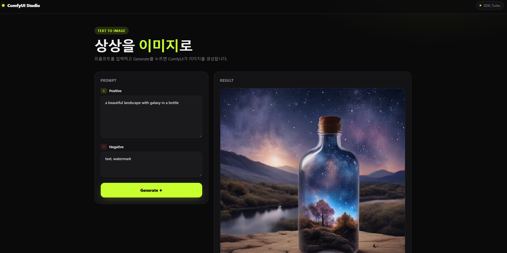
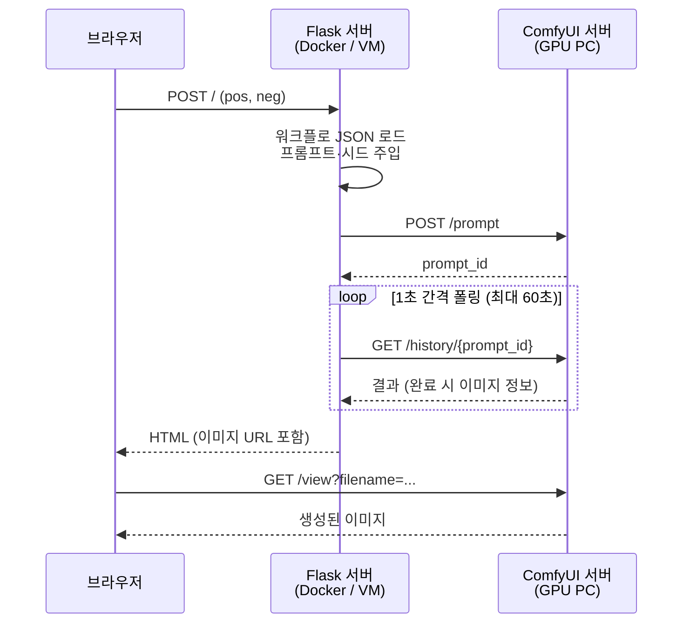

# ComfyUI Studio: 텍스트로 이미지를 만드는 웹 앱

> 프롬프트를 입력하면 **ComfyUI API**로 Stable Diffusion(SDXL Turbo) 워크플로를 실행하고, 생성된 이미지를 웹에서 바로 보여주는 Flask 애플리케이션입니다.

<!-- 스크린샷: docs/images/screenshot.png 파일을 추가하면 아래에 표시됩니다 -->


<br>

## 프로젝트 개요

| 항목 | 내용 |
| --- | --- |
| 목적 | ComfyUI의 노드 기반 워크플로를 **누구나 쓸 수 있는 웹 UI**로 감싸기 |
| 기능 | Positive/Negative 프롬프트 입력 → 이미지 생성 → 결과 표시 |
| 모델 | SDXL Turbo (`sd_xl_turbo_1.0_fp16`, 1-step 샘플링) |
| 배포 | Docker 개발 환경 → 학교 VMware 서버(Linux)에 배포 |

ComfyUI는 강력하지만 노드 그래프 화면이 복잡해서 처음 쓰는 사람이 다루기 어렵습니다.
이 프로젝트는 ComfyUI에서 만든 워크플로를 **API 형식 JSON**으로 저장해 두고, 웹에서는 프롬프트만 입력하면 되도록 만들었습니다.

<br>

## 주요 기능

- **텍스트 → 이미지 생성**: Positive / Negative 프롬프트로 이미지 생성
- **매번 다른 결과**: 요청마다 시드를 랜덤으로 바꿔 같은 프롬프트로도 새로운 이미지 생성
- **생성 상태 표시**: 생성 중에는 버튼 비활성화, 스피너, 결과 영역 애니메이션
- **다크 UI**: 다크 베이스에 네온 그린 포인트, 모바일 반응형 레이아웃
- **환경 변수 설정**: ComfyUI 주소를 코드 수정 없이 환경 변수로 변경
- **Docker 지원**: `docker compose up` 한 줄로 실행 환경 구성

<br>

## 아키텍처



| 구성 요소 | 역할 |
| --- | --- |
| **Flask** (`app2.py`) | 워크플로에 프롬프트를 주입하고 ComfyUI에 제출, 완료될 때까지 폴링 |
| **ComfyUI** | 실제 이미지 생성 (GPU) |
| **워크플로** (`static/test.json`) | ComfyUI에서 설계한 노드 그래프 (API 형식) |
| **템플릿** (`templates/image.html`) | 입력 폼과 결과 화면 |

<br>

## 기술 스택

| 분류 | 사용 기술 |
| --- | --- |
| Backend | Python 3.12, Flask, requests |
| AI / 이미지 생성 | ComfyUI, Stable Diffusion XL Turbo |
| Frontend | HTML, CSS, Vanilla JS (Jinja2 템플릿, 외부 라이브러리 없음) |
| Infra | Docker, Docker Compose, VMware (Linux VM), SSH / scp |

**테스트 환경**: ComfyUI 0.45.0 · PyTorch 2.15.0 (CUDA 13.2) · NVIDIA RTX 3080 10GB · Flask 3.1.3 · Python 3.12 ([상세](docs/README.md#테스트한-환경))

<br>

## 핵심 구현

### 1. 워크플로 재사용과 프롬프트 주입

ComfyUI에서 저장한 API 형식 JSON을 불러와 노드 ID로 필요한 값만 바꿉니다.

```python
def update_prompts(graph, pos, neg, pos_node_id="6", neg_node_id="7"):
    graph["13"]["inputs"]["noise_seed"] = random.randint(0, 2**32 - 1)  # 시드 랜덤화
    graph[pos_node_id]["inputs"]["text"] = pos
    graph[neg_node_id]["inputs"]["text"] = neg
    return graph
```

### 2. 비동기 작업의 완료 대기 (폴링)

ComfyUI의 `/prompt`는 작업을 큐에 넣고 바로 `prompt_id`만 돌려줍니다.
그래서 `/history/{prompt_id}`를 1초 간격으로 조회해 결과가 나올 때까지 기다립니다.

```python
while time.time() < end:
    h = requests.get(f"{COMFY_URL}/history/{prompt_id}")
    if h.status_code == 200 and h.json():
        return list(h.json().values())[0]
    time.sleep(interval)
```

### 3. 서버용 주소와 브라우저용 주소 분리

| 환경 변수 | 누가 사용하나 | 예시 |
| --- | --- | --- |
| `COMFY_URL` | Flask 서버가 API 호출 | `http://host.docker.internal:8188` |
| `PUBLIC_COMFY_URL` | 브라우저가 이미지 로드 | `http://192.168.0.10:8188` |

<br>

## 트러블슈팅

개발하면서 실제로 겪은 문제와 해결 과정입니다.

### 결과 이미지가 화면에 나오지 않음

- **원인**: 이미지 URL을 컨테이너 전용 주소(`host.docker.internal`)로 만들었습니다. `` 태그는 서버가 아니라 **브라우저가 직접** 요청하기 때문에, 브라우저에서는 이 주소에 접근할 수 없었습니다.
- **해결**: 서버가 쓰는 주소(`COMFY_URL`)와 브라우저가 쓰는 주소(`PUBLIC_COMFY_URL`)를 분리했습니다.
- **배운 점**: 같은 URL이라도 **어디에서 요청하느냐**에 따라 접근 가능 여부가 달라진다는 것을 알게 됐습니다.


### 같은 프롬프트로 생성하면 항상 같은 이미지

- **원인**: 워크플로 JSON의 `noise_seed`가 고정값으로 저장되어 있었습니다. 또 ComfyUI는 입력이 같으면 캐시된 결과를 재사용합니다.
- **해결**: 요청마다 `random.randint()`로 시드를 바꾸도록 했습니다.

### 다른 PC에서 clone하면 실행되지 않음

- **원인**: ComfyUI의 IP가 코드에 하드코딩되어 있었고, Docker 실행 환경(이미지, 포트)이 저장소에 없었습니다.
- **해결**: 주소를 환경 변수로 바꾸고 `Dockerfile`, `docker-compose.yml`, `requirements.txt`를 추가해 어디서나 같은 환경을 재현할 수 있게 했습니다.

<br>

## 빠른 시작

> 사전 준비: NVIDIA GPU PC에 **ComfyUI 설치와 SDXL Turbo 모델**이 필요합니다. [설치 가이드](docs/README.md#1-comfyui-설치와-모델-다운로드)를 참고하세요.

```bash
git clone <이 저장소 URL>
cd comfyui
```

`docker-compose.yml`의 `COMFY_URL`, `PUBLIC_COMFY_URL`을 **본인 PC 주소**로 바꾼 뒤 실행합니다.

```bash
docker compose up --build
```

브라우저에서 `http://localhost:5000`에 접속합니다.

Docker 없이 실행하거나 VM 서버에 배포하는 방법은 [docs/README.md](docs/README.md)에 정리되어 있습니다.

<br>

## 프로젝트 구조

```
comfyui/
├── app2.py               # Flask 앱 (워크플로 제출, 폴링, 결과 URL 생성)
├── templates/
│   └── image.html        # UI (입력 폼 + 결과 화면)
├── static/
│   └── test.json         # ComfyUI 워크플로 (API 형식, SDXL Turbo)
├── docs/
│   └── README.md         # 설치·배포 가이드 (ComfyUI, Docker, VM)
├── Dockerfile
├── docker-compose.yml
└── requirements.txt
```

<br>

## 개선 계획

- [ ] 생성 요청을 비동기(AJAX)로 바꿔 페이지 새로고침 없이 결과 표시
- [ ] Flask가 이미지를 대신 전달하는 프록시 라우트로 ComfyUI 주소를 브라우저에 노출하지 않기
- [ ] 이미지 크기, 스텝 수, 시드 등 옵션을 UI에서 조정
- [ ] 생성 기록(갤러리) 저장
- [ ] ComfyUI 연결 실패와 시간 초과 시 사용자에게 오류 메시지 표시
