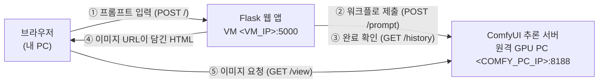

# 원격 ComfyUI 서버로 Flux.2 이미지 생성하기

다른 PC에서 돌아가는 ComfyUI를 **원격 추론 서버**로 쓰고, 그 서버에서 받은 **Flux.2 Klein 워크플로(`flux2.json`)**로 이미지를 생성하도록 앱을 바꾼 과정을 기록한 문서입니다.

- 기존: 같은 네트워크의 ComfyUI + SDXL Turbo 워크플로(`static/test.json`)
- 변경: 다른 PC의 ComfyUI + Flux.2 Klein 4B 워크플로(`static/flux2.json`)

## 목차

1. [전체 구성](#1-전체-구성)
2. [원격 ComfyUI 서버 준비](#2-원격-comfyui-서버-준비)
3. [워크플로를 API 형식으로 받아오기](#3-워크플로를-api-형식으로-받아오기)
4. [워크플로 분석: 바꿀 노드 찾기](#4-워크플로-분석-바꿀-노드-찾기)
5. [코드 수정](#5-코드-수정)
6. [VM 서버에 배포하고 실행](#6-vm-서버에-배포하고-실행)
7. [겪은 문제와 해결](#7-겪은-문제와-해결)
8. [SDXL Turbo와 비교](#8-sdxl-turbo와-비교)

문서의 `<...>`는 본인 환경 값으로 바꿔서 읽으세요.

| 표기 | 의미 |
| --- | --- |
| `<COMFY_PC_IP>` | 원격 ComfyUI(추론 서버)가 돌아가는 PC의 IP |
| `<VM_IP>` | Flask 웹 앱을 실행하는 VM 서버의 IP |
| `<VM_USER>` | VM 계정 ID |

---

## 1. 전체 구성



| 구성 요소 | 위치 | 하는 일 |
| --- | --- | --- |
| 브라우저 | 내 PC | `http://<VM_IP>:5000`에 접속해서 프롬프트를 입력 |
| Flask 웹 앱 | VM 서버 | 워크플로 JSON에 프롬프트를 넣어 ComfyUI에 보내고, 끝날 때까지 기다림 |
| ComfyUI | 원격 GPU PC | Flux.2 모델로 실제 이미지를 생성하고 저장 |

웹 앱은 GPU가 필요 없습니다. 이미지 생성은 모두 원격 PC의 GPU에서 일어나고, 웹 앱은 HTTP 요청만 주고받습니다.
그래서 GPU가 없는 VM에서도 웹 앱을 돌릴 수 있습니다.

---

## 2. 원격 ComfyUI 서버 준비

원격 PC에서 할 일입니다. ComfyUI 설치 방법은 [설치·배포 가이드](README.md#1-comfyui-설치와-모델-다운로드)를 참고하세요.

### 2-1. 외부 접속 허용

ComfyUI는 기본적으로 자기 PC(`127.0.0.1`)에서 오는 요청만 받습니다. VM과 다른 PC에서 접속할 수 있게 `--listen 0.0.0.0`으로 실행합니다.

```bash
python main.py --listen 0.0.0.0 --port 8188
```

Windows라면 방화벽에서 **TCP 8188 인바운드**를 허용합니다.

### 2-2. Flux.2 Klein 모델 준비

`flux2.json`은 모델을 세 부분으로 나눠서 불러옵니다. SDXL Turbo처럼 체크포인트 파일 하나로 끝나지 않습니다.

| 노드 | 파일 | 넣을 폴더 |
| --- | --- | --- |
| `UNETLoader` (확산 모델) | `flux-2-klein-base-4b.safetensors` | `ComfyUI/models/diffusion_models/` |
| `CLIPLoader` (텍스트 인코더, type `flux2`) | `qwen_3_4b.safetensors` | `ComfyUI/models/text_encoders/` |
| `VAELoader` (VAE) | `flux2-vae.safetensors` | `ComfyUI/models/vae/` |

> ComfyUI 화면에서 Flux.2 Klein 템플릿을 열면 빠진 모델 파일을 알려주고 다운로드 링크를 보여줍니다. 파일 이름이 위 표와 정확히 같아야 합니다.

### 2-3. 연결 확인

Flask를 실행할 곳(VM)에서 원격 ComfyUI에 접속되는지 확인합니다.

```bash
python3 -c "import urllib.request as u;print(u.urlopen('http://<COMFY_PC_IP>:8188/history',timeout=5).status)"
```

`200`이 나오면 정상입니다. 서버 버전과 GPU 정보는 브라우저에서 `http://<COMFY_PC_IP>:8188/system_stats`를 열면 볼 수 있습니다.

---

## 3. 워크플로를 API 형식으로 받아오기

ComfyUI 화면에서 저장하는 워크플로는 두 가지 형식이 있습니다.

| 형식 | 용도 | 이 앱에서 사용 |
| --- | --- | --- |
| 일반 저장 (`Save`) | 화면 배치(노드 위치, 연결선)까지 저장. ComfyUI 화면에서 다시 열 때 사용 | ✗ |
| **API 형식** (`Export (API)`) | 실행에 필요한 노드와 입력값만 저장. `/prompt` API에 그대로 보낼 수 있음 | ✓ |

순서는 다음과 같습니다.

1. 브라우저에서 원격 ComfyUI(`http://<COMFY_PC_IP>:8188`)를 엽니다.
2. Flux.2 Klein 워크플로를 엽니다.
3. **Queue(Run)를 한 번 눌러** 그 서버에서 실제로 이미지가 생성되는지 확인합니다. 모델 파일이 빠졌거나 노드가 없으면 여기서 오류가 납니다.
4. 메뉴에서 **Workflow → Export (API)**로 저장합니다. 이전 버전 UI에서는 설정에서 Dev mode를 켜면 보이는 `Save (API Format)`입니다.
5. 저장한 파일을 `static/flux2.json`으로 프로젝트에 넣습니다.

> 3번이 중요합니다. ComfyUI 화면에서 돌아가지 않는 워크플로는 API로 보내도 돌아가지 않습니다. 먼저 화면에서 확인해 두면 이후에 문제가 생겼을 때 원인이 워크플로인지 코드인지 쉽게 구분할 수 있습니다.

---

## 4. 워크플로 분석: 바꿀 노드 찾기

웹에서 입력한 프롬프트를 넣으려면 JSON에서 **어느 노드의 어느 값**을 바꿔야 하는지 알아야 합니다.
API 형식 JSON은 `{ "노드ID": { "class_type": ..., "inputs": {...} } }` 구조입니다. 노드 목록은 이렇게 출력해 볼 수 있습니다.

```bash
python3 -c "
import json
g = json.load(open('static/flux2.json'))
for k, v in g.items():
    print(k, v['class_type'], v['inputs'])
"
```

### 4-1. flux2.json의 주요 노드

| 노드 ID | class_type | 주요 입력 | 역할 |
| --- | --- | --- | --- |
| `76` | `PrimitiveStringMultiline` | `value` | **Positive 프롬프트 원문** |
| `75:74` | `CLIPTextEncode` | `text` ← `76`에 연결 | Positive 인코딩 |
| `75:67` | `CLIPTextEncode` | `text` | **Negative 프롬프트** |
| `75:73` | `RandomNoise` | `noise_seed` | **시드** |
| `75:63` | `CFGGuider` | `cfg: 5`, positive ← `75:74`, negative ← `75:67` | 프롬프트 가이드 |
| `75:62` | `Flux2Scheduler` | `steps: 20` | 스텝 수 |
| `75:68`, `75:69` | `PrimitiveInt` | `value: 1024` | 이미지 너비, 높이 |
| `75:64` | `SamplerCustomAdvanced` | | 샘플링 |
| `75:65` | `VAEDecode` | | latent → 이미지 |
| `9` | `SaveImage` | `filename_prefix: Flux2-Klein` | **결과 저장** (앱이 결과를 읽는 노드) |

어떤 노드가 Positive이고 어떤 노드가 Negative인지는 `CFGGuider`(`75:63`)의 `positive`, `negative` 입력이 어느 노드에 연결되어 있는지 보고 판단했습니다.

### 4-2. SDXL Turbo 워크플로(test.json)와 다른 점

| 역할 | test.json | flux2.json |
| --- | --- | --- |
| Positive 프롬프트 | `"6"` → `inputs.text` | `"76"` → `inputs.value` |
| Negative 프롬프트 | `"7"` → `inputs.text` | `"75:67"` → `inputs.text` |
| 시드 | `"13"` → `noise_seed` (`SamplerCustom`) | `"75:73"` → `noise_seed` (`RandomNoise`) |
| 결과 저장 | `"27"` (`SaveImage`) | `"9"` (`SaveImage`) |

주의할 점이 두 가지 있습니다.

- **Positive의 키 이름이 다릅니다.** flux2.json은 프롬프트를 `CLIPTextEncode`에 직접 쓰지 않고, 텍스트 노드(`PrimitiveStringMultiline`)를 거쳐 연결합니다. 이 노드의 입력 이름은 `text`가 아니라 `value`입니다.
- **노드 ID에 `:`가 들어갑니다.** `75:74` 같은 ID는 워크플로가 **서브그래프(노드 묶음)** `75` 안의 노드라는 뜻입니다. API로 내보내면 `서브그래프ID:노드ID` 형태가 됩니다. 문자열 키이므로 코드에서 `graph["75:74"]`처럼 그대로 쓰면 됩니다.

결과를 읽는 `extract_first_image_url`은 `outputs`에서 이미지가 있는 노드를 찾아 쓰기 때문에, SaveImage의 노드 번호가 바뀌어도 수정할 필요가 없었습니다.

---

## 5. 코드 수정

`app2.py`에서 세 곳을 바꿨습니다.

### 5-1. 워크플로 경로

```python
WORKFLOW_PATH = os.getenv("WORKFLOW_PATH", "./static/flux2.json")
```

코드를 고치지 않고 환경 변수로도 바꿀 수 있습니다.

```bash
export WORKFLOW_PATH="./static/flux2.json"
```

### 5-2. 프롬프트와 시드를 넣는 노드

```python
# 변경 전 (SDXL Turbo, test.json)
def update_prompts(graph: dict, pos: str, neg: str,
                    pos_node_id: str = "6", neg_node_id: str = "7") -> dict:
    graph["13"]["inputs"]["noise_seed"] = random.randint(0, 2**32 - 1)
    graph[pos_node_id]["inputs"]["text"] = pos
    graph[neg_node_id]["inputs"]["text"] = neg
    return graph

# 변경 후 (Flux.2 Klein, flux2.json)
def update_prompts(graph: dict, pos: str, neg: str,
                    pos_node_id: str = "76", neg_node_id: str = "75:67") -> dict:
    graph["75:73"]["inputs"]["noise_seed"] = random.randint(0, 2**32 - 1) # 시드 랜덤화
    graph[pos_node_id]["inputs"]["value"] = pos   # PrimitiveStringMultiline 은 "value"
    graph[neg_node_id]["inputs"]["text"] = neg
    return graph
```

> 웹에서 입력한 Positive 프롬프트가 노드 `76`의 기본 문장(`8k, ultra-realistic, ... no text, no low quality.`)을 **통째로 덮어씁니다.** 화질 관련 문구가 필요하면 웹에서 함께 입력하세요.

### 5-3. ComfyUI 주소

원격 서버를 가리키도록 환경 변수를 지정합니다.

```bash
export COMFY_URL="http://<COMFY_PC_IP>:8188"
export PUBLIC_COMFY_URL="http://<COMFY_PC_IP>:8188"
```

두 값이 같은 이유:

| 변수 | 누가 접속하나 | 값 |
| --- | --- | --- |
| `COMFY_URL` | VM의 Flask가 프롬프트를 보낼 때 | 원격 ComfyUI 주소 |
| `PUBLIC_COMFY_URL` | 내 PC 브라우저가 결과 이미지를 불러올 때 | 원격 ComfyUI 주소 |

생성된 이미지는 **원격 ComfyUI PC에 저장**됩니다. Flask는 이미지를 갖고 있지 않고 "이미지는 여기 있다"는 주소만 브라우저에 알려줍니다.
그래서 `PUBLIC_COMFY_URL`에는 웹 앱 주소(`<VM_IP>:5000`)나 내 PC IP가 아니라 **ComfyUI 주소**를 넣어야 합니다.
VM과 내 PC 모두 같은 네트워크에서 원격 ComfyUI에 접속할 수 있으니 두 값은 같아집니다.

---

## 6. VM 서버에 배포하고 실행

### 6-1. 프로젝트 전체 복사

새 파일(`static/flux2.json`)이 생겼으므로 폴더 전체를 다시 복사합니다. 개발 컨테이너 터미널에서 실행합니다.

```bash
scp -r /workspace/comfyui <VM_USER>@<VM_IP>:~/
```

VM의 `~/comfyui`에 덮어쓰기로 합쳐집니다. VM에만 있는 `venv/`와 `app.log`는 그대로 남으므로 패키지를 다시 설치할 필요가 없습니다.

### 6-2. 서버 재시작

`app2.py`가 바뀌었으므로 재시작합니다.

```bash
ssh <VM_USER>@<VM_IP>
cd ~/comfyui
source venv/bin/activate
pkill -f app2.py                                   # 실행 중이던 서버 종료
export COMFY_URL="http://<COMFY_PC_IP>:8188"
export PUBLIC_COMFY_URL="http://<COMFY_PC_IP>:8188"
python app2.py
```

### 6-3. 확인

1. 브라우저에서 `http://<VM_IP>:5000`을 열고 Generate를 누릅니다.
2. VM 터미널에 `"POST / HTTP/1.1" 200`이 찍히는지 봅니다.
3. 원격 ComfyUI 화면(`http://<COMFY_PC_IP>:8188`)의 큐에서 작업이 실행되는지 봅니다.
4. 결과 이미지가 웹에 나오면 완료입니다.

---

## 7. 겪은 문제와 해결

처음 두 가지는 VM에 배포하기 전에 코드를 점검하다가 발견한 문제이고, 세 번째는 실제로 실행하면서 겪은 문제입니다.

### `KeyError: '13'`: 노드 번호가 맞지 않음

- **문제**: 워크플로만 `flux2.json`으로 바꾸면 Generate를 누를 때 500 오류(`KeyError`)가 나는 상태였습니다.
- **원인**: `update_prompts`가 SDXL 워크플로의 노드 번호(`6`, `7`, `13`)를 그대로 고치려 하는데, flux2.json에는 이 노드가 없습니다.
- **해결**: [4장](#4-워크플로-분석-바꿀-노드-찾기)처럼 노드를 분석해서 `76`, `75:67`, `75:73`으로 바꾸고, Positive 키를 `value`로 바꿨습니다.
- **배운 점**: 워크플로 JSON은 워크플로마다 노드 번호와 입력 이름이 다릅니다. 워크플로를 바꿀 때는 코드의 노드 번호도 함께 확인해야 합니다.

### `TemplateNotFound: flux2.html`

- **문제**: 페이지를 열자마자 오류가 나는 상태였습니다.
- **원인**: `render_template("flux2.html")`로 바꿨는데 `templates/`에 그 파일이 없었습니다.
- **해결**: 기존 `image.html`을 그대로 쓰도록 되돌렸습니다. 폼 필드(`pos`, `neg`)와 변수(`img_url`)가 같아서 워크플로가 바뀌어도 템플릿은 그대로 쓸 수 있습니다.

### 응답은 `200`인데 이미지가 안 나옴

- **증상**: VM 로그에 `"POST / HTTP/1.1" 200`이 찍히는데 결과 화면에 이미지가 없습니다.
- **원인**: Flux.2는 이미지 한 장에 **약 35초**(RTX 3080, 1024×1024, 20스텝) 걸립니다. 그런데 Generate를 여러 번 눌러 ComfyUI 큐에 작업이 쌓여 있었습니다(실행 중 1개, 대기 3개). 앞 작업이 끝날 때까지 기다리는 사이 `poll_history`의 제한 시간 60초가 먼저 지나서, 이미지 없이 페이지가 그려졌습니다. 오류가 아니라 시간 초과라서 로그는 `200`입니다.
- **확인 방법**: ComfyUI의 `/queue`와 `/history` API를 조회해 보니, 작업은 모두 `success`로 끝나 있었고 결과 이미지도 저장되어 있었습니다. 문제는 생성이 아니라 기다리는 시간이었습니다.
  ```bash
  python3 -c "import urllib.request as u,json;q=json.load(u.urlopen('http://<COMFY_PC_IP>:8188/queue'));print('running',len(q['queue_running']),'pending',len(q['queue_pending']))"
  ```
- **해결**: 큐가 빈 상태에서 Generate를 한 번만 누르니 35초 정도 뒤에 정상적으로 이미지가 나왔습니다.
- **남은 과제**: 큐가 쌓이거나 여러 사람이 동시에 쓰면 다시 시간 초과가 날 수 있습니다. `poll_history(prompt_id, timeout_sec=300)`처럼 제한 시간을 늘리고, 시간 초과일 때 화면에 메시지를 보여주는 것이 좋습니다.

---

## 8. SDXL Turbo와 비교

| 항목 | SDXL Turbo (`test.json`) | Flux.2 Klein 4B (`flux2.json`) |
| --- | --- | --- |
| 해상도 | 512 × 512 | 1024 × 1024 |
| 스텝 | 1 | 20 |
| CFG | 1 | 5 |
| 샘플러 | `euler_ancestral` | `euler` |
| 모델 파일 | 체크포인트 1개 | 확산 모델, 텍스트 인코더(Qwen3 4B), VAE 3개 |
| 생성 시간 (RTX 3080) | 측정하지 않음 | 약 35초 |

테스트 환경: ComfyUI 0.45.0 · PyTorch 2.15.0 (CUDA 13.2) · NVIDIA RTX 3080 10GB

### 워크플로를 다시 SDXL Turbo로 돌리려면

`WORKFLOW_PATH`를 `./static/test.json`으로 바꾸고, `update_prompts`도 변경 전 코드로 되돌려야 합니다.
두 워크플로를 자주 오간다면 워크플로 파일 이름별로 노드 정보를 정해 두고 자동으로 고르게 하는 방법이 편합니다.

```python
NODE_MAP = {
    "test.json":  {"pos": ("6", "text"),   "neg": ("7", "text"),     "seed": ("13", "noise_seed")},
    "flux2.json": {"pos": ("76", "value"), "neg": ("75:67", "text"), "seed": ("75:73", "noise_seed")},
}
```
